# Cricket Data - Exploratory Data Analysis Report

_Generated 04 Nov 2026, 08:26 from `data/cricket.db`_

## Key findings

1. Columns with most missing data: `toss_won_match` (36%), `toss_winner` (34%), `toss_decision` (34%). Some gaps are by design (`batting_first_won` only exists for ODI/T20 results); toss and result fields depend on what the API supplies.
2. **T20** is the most common format (50% of matches).
3. Average run rate by format: ODI = 5.72, T20 = 9.39, Test = 2.89.
4. Best win rate: **South Africa** with 58.0% from 81 matches.
5. Busiest venue: **Lord's, London** (33 matches).
6. Teams batting first win 49% of ODI, 49% of T20 matches.
7. 1 of 4 statistical tests were significant at the 5% level.

## Summary

T20 is the biggest format in this data. Run rate goes down from T20 to ODI to Test. Neither batting first nor winning the toss gave a clear advantage. The main weakness is that the data is only what the API returned, and some fields (toss) and some Test scores are not reliable.

## 1. Data overview & quality

- **Matches:** 563  |  **Innings:** 1,275  |  **Teams:** 75  |  **Venues:** 48
- **Date range:** 13 Jan 2018 -> 02 Nov 2026
- **Formats:** T20: 283, ODI: 176, Test: 104
- **Women's matches:** 16.2%

**Innings summary statistics**

|       |    runs |   wickets |   overs |   run_rate |
|:------|--------:|----------:|--------:|-----------:|
| count | 1275    |   1275    | 1275    |    1275    |
| mean  |  216.72 |      7.05 |   51.09 |       6.46 |
| std   |  109.85 |      3.11 |   41.61 |       3.99 |
| min   |    8    |      0    |    1    |       0.37 |
| 25%   |  145    |      4    |   20    |       3.59 |
| 50%   |  190    |      8    |   38    |       5.84 |
| 75%   |  270.5  |     10    |   79.25 |       8.28 |
| max   |  839    |     10    |  186.1  |      26.5  |

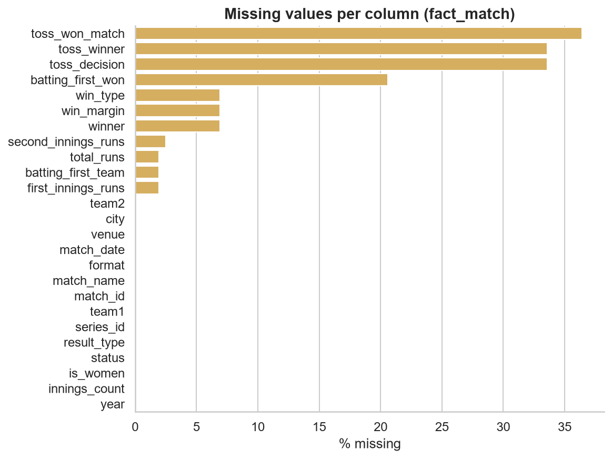

**What we noticed**

The data has 563 completed matches and 1,275 innings from 75 teams and 48 venues. The matches run from January 2018 to November 2026, but we do not know if the API gives every match played in those years, so we treat this as a sample and not as the full history of cricket. T20 is half of the matches (283), then ODI (176) and Test (104). About 16% are women's matches.

In the innings table the mean score (216.7) is higher than the median (190). This is probably because of Test cricket, where one innings can go on for a very long time. T20, ODI and Test are mixed together here, so the overall mean and the overs column do not say much on their own. We compare the formats separately in the next sections. The highest run rate (26.5) most likely comes from an innings of only a few overs.

The toss columns are empty for about 35% of the matches because the API does not always send toss details. Every toss result in this report uses only the matches that have it (358 of 563).

## 2. Univariate analysis

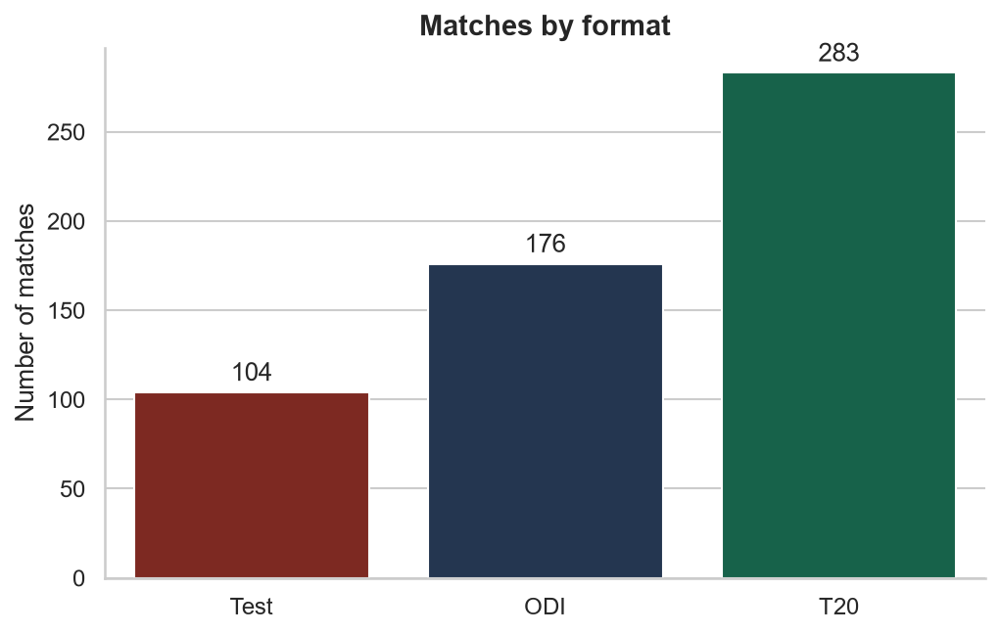

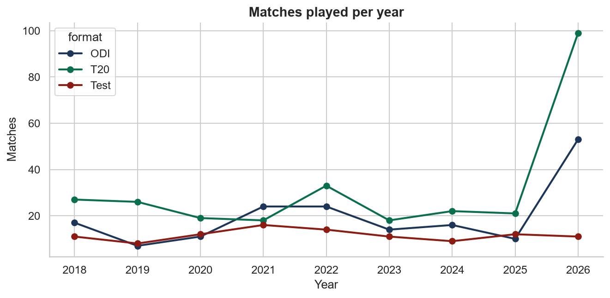

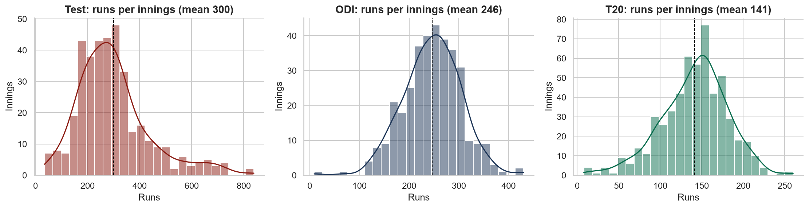

**What we noticed**

T20 is about 50% of the matches, ODI about 31% and Test about 18%. ODI and T20 matches have almost exactly two innings each (1.97 and 1.94 per match), while Test matches have 3.6 on average, since a Test can have up to four innings. These counts only show what the API returned. They do not tell us how many matches of each format were really played.

## 3. Bivariate & multivariate analysis

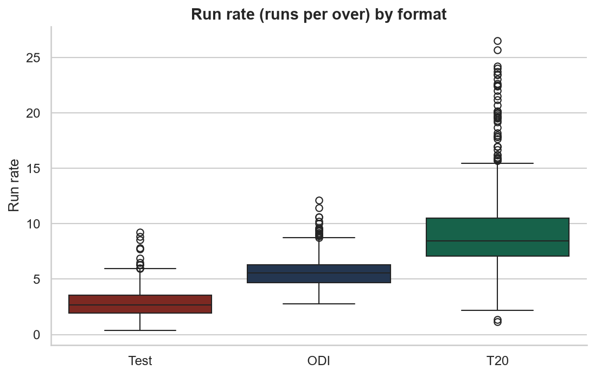

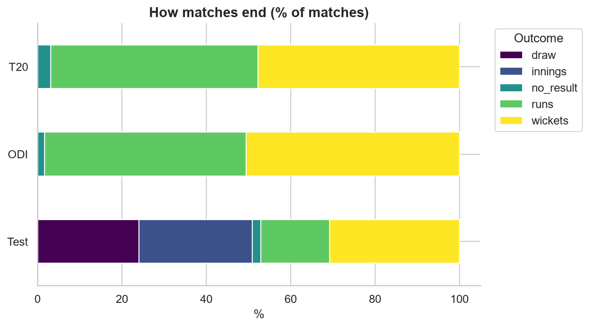

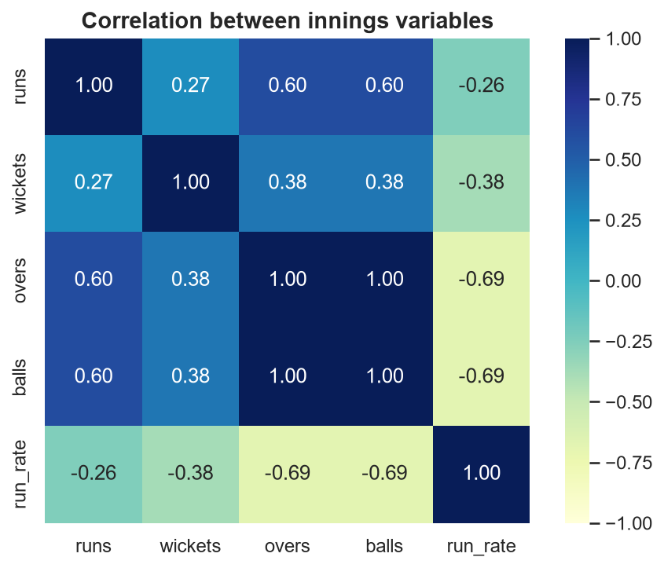

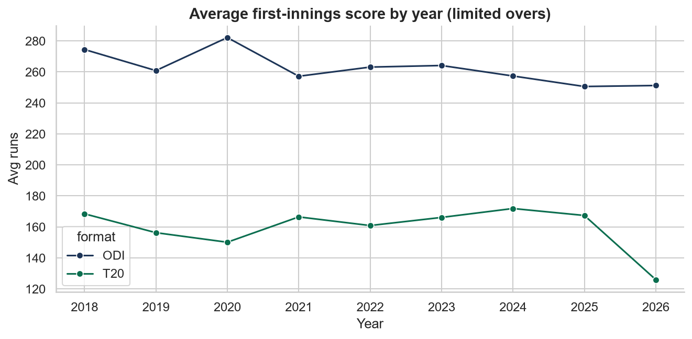

**What we noticed**

Run rate goes down as the format gets longer: 9.39 in T20, 5.72 in ODI and 2.89 in Test. This makes sense, because a T20 team has only 20 overs and has to score fast, while in a Test there is no limit on overs. The Kruskal-Wallis test agrees (p is almost zero), so the difference between formats is not by chance. This test does not need the data to be normally distributed.

In the correlation heatmap, overs and balls hold the same information, so they are almost perfectly correlated by construction. That is not a real finding. Draws are only possible in Tests, which is why the result chart looks different for Test.

## 4. Team & venue analysis

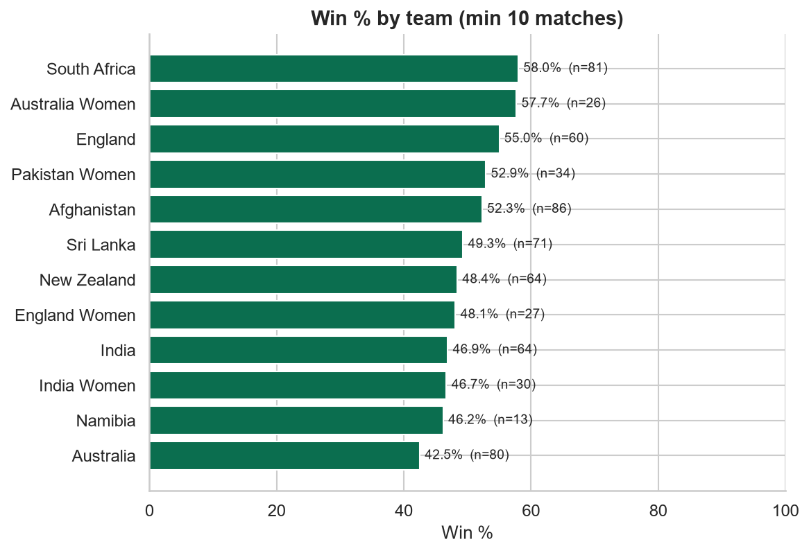

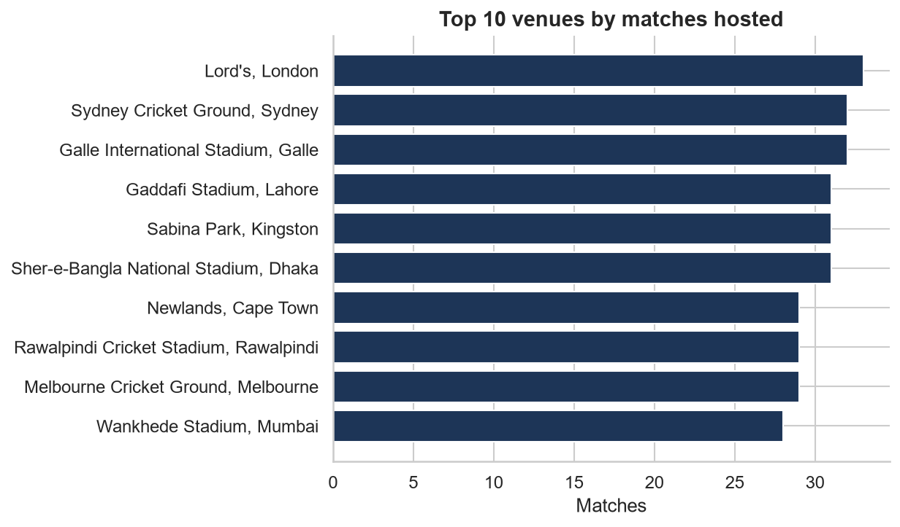

**What we noticed**

South Africa has the best win rate in the table (58.0% from 81 matches). We only show teams with at least 10 matches, so a team with one or two matches cannot get 100% by luck. The win percentage is wins divided by all matches played, so drawn Tests and matches with no result count against a team. Because this is only a sample from the API, the table should not be read as an official ranking.

Lord's in London hosted the most matches (33) out of 48 venues. This also depends on which matches the API contains.

## 5. Match-situation analysis

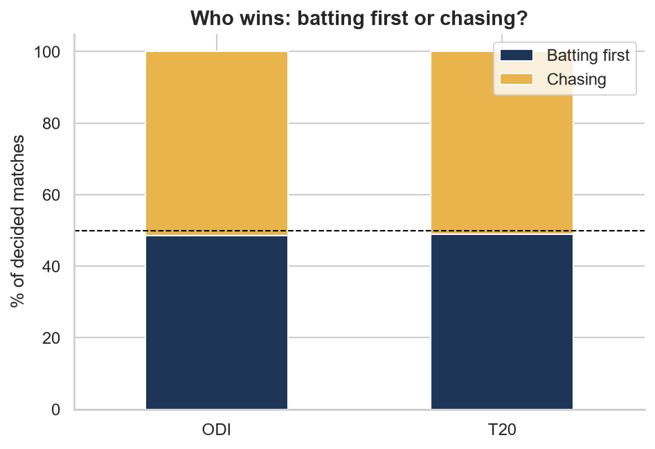

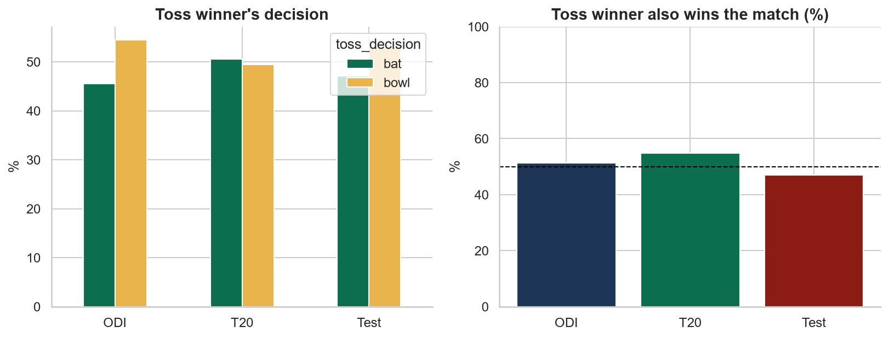

**What we noticed**

The team batting first won 48.6% of ODIs (84 of 173) and 48.9% of T20s (134 of 274), so chasing was only a little better in this data. The binomial test gives p = 0.76 for both, so we cannot say that batting first or chasing has an advantage. A difference this small can easily happen by chance. The toss winner won 52.5% of the matches (188 of 358) with p = 0.37, which is also not significant.

Not significant does not prove that there is no advantage. It only means that with 173 to 358 matches we cannot detect a small one.

## 6. Statistical tests & outliers

| Question                                               | Result          |    p-value | Conclusion (alpha = 0.05)   |
|:-------------------------------------------------------|:----------------|-----------:|:----------------------------|
| ODI: is batting first a 50/50 advantage?               | 84/173 = 48.6%  | 0.7611     | Not significant             |
| T20: is batting first a 50/50 advantage?               | 134/274 = 48.9% | 0.7627     | Not significant             |
| Does winning the toss help win the match?              | 188/358 = 52.5% | 0.369      | Not significant             |
| Is run rate different across formats? (Kruskal-Wallis) | H = 834.4       | 6.359e-182 | Significant                 |

**Outlier check (1.5 x IQR rule on runs per innings)**

| format   |   innings |   outliers |   outlier_% |   max_runs |
|:---------|----------:|-----------:|------------:|-----------:|
| ODI      |       347 |          4 |         1.2 |        430 |
| T20      |       550 |         13 |         2.4 |        260 |
| Test     |       378 |         26 |         6.9 |        839 |

_Outliers were inspected, not deleted: high scores such as 250+ in T20 or 400+ in ODI are real cricket events, not data errors._

**Five highest innings in the dataset**

| format   | team        |   runs |   wickets |   overs |
|:---------|:------------|-------:|----------:|--------:|
| Test     | Australia   |    839 |        10 |   133.1 |
| Test     | West Indies |    830 |        10 |   147.2 |
| Test     | New Zealand |    740 |        10 |    96   |
| Test     | West Indies |    730 |        10 |   106.1 |
| Test     | Afghanistan |    726 |        10 |   137.2 |

**What we noticed**

Only one of the four tests was significant, the difference in run rate between formats. The tests for batting first (ODI and T20) and for the toss were not significant.

With the 1.5 x IQR rule we found 4 outliers in ODI (1.2%), 13 in T20 (2.4%) and 26 in Test (6.9%). The share is highest in Tests, which is normal because Test scores vary a lot from innings to innings.

All five highest innings are Tests, and some of them look too high to us. For example 839 for Australia in 133.1 overs, 740 for New Zealand in 96 overs and 726 for Afghanistan are higher than we would expect for one Test innings. We think the API may sometimes give the total of both innings in one row, or that some of these matches are not normal Tests, but we have not confirmed this. We kept these rows in the database and did not use them to draw conclusions about run scoring in Tests.

## Limitations

- The API is not guaranteed to return every match, so the data is a sample.
- Toss details are missing for about a third of the matches.
- Some Test scores look too high (see section 6).
- Some matches belong to series that we did not download, so their series name is "Unknown series".
- There is no player level data, only team and match data.